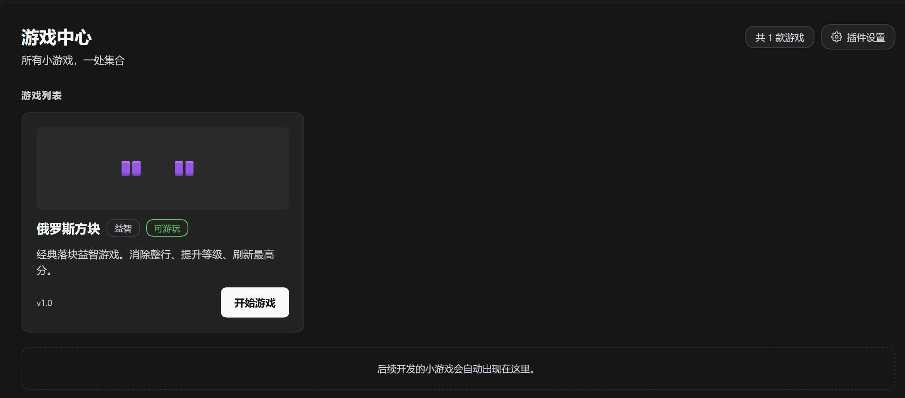
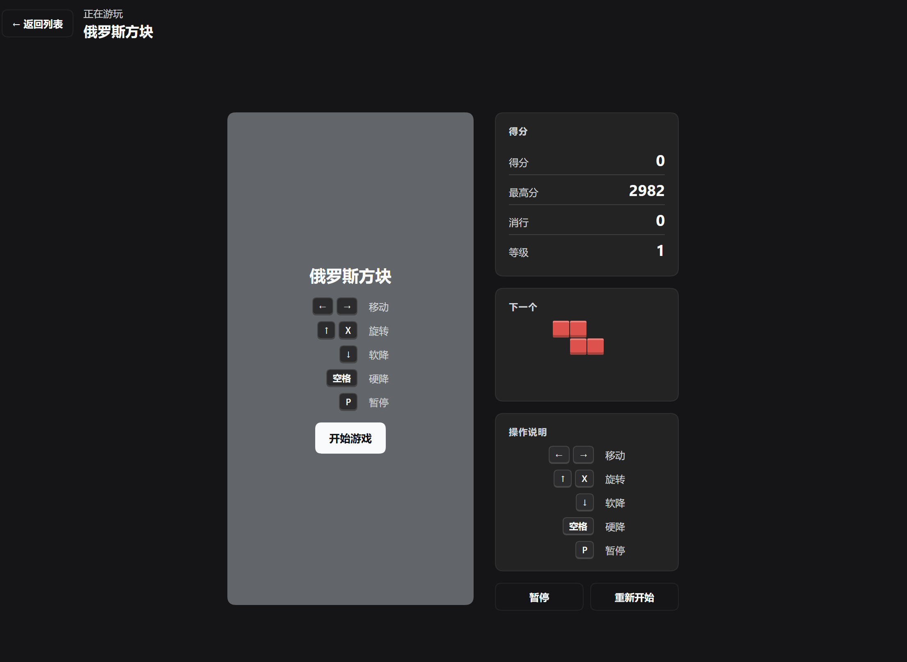

# Game Center

[English](#english) | [中文](#中文)


---

## English

A DeepSeek Harness panel plugin that keeps the mini-games built for this harness in one place, and lets you play them without leaving the window. Ships with Tetris and Cops & Robbers.





### Requirements

| | |
| --- | --- |
| DeepSeek Harness | `0.2.1-rc.5` or newer (Web UI; verified on `0.2.2-rc.1`) |
| Node.js | `>= 22` |
| npm dependencies | none at runtime — the panel injects `@deepseek-ai/dsh-client-locale` and `@deepseek-ai/dsh-client-ui-slots`, which the harness provides |

### Install

The plugin is listed in the [awesome-dsh-plugin catalog](https://awesome-dsh-plugin.com/p/stallenlu/dsh-game-center/), so it appears in **dshmarket** and in DSH's **Plugins → Discover**: search for *Game Center*, *游戏中心* or *Tetris* and click **Install**. That is the easiest path.

It is also published through three channels you can install from directly:

| Channel | Command | Notes |
| --- | --- | --- |
| dshmarket / Discover | search **Game Center** | one-click; the catalog entry lives in awesome-dsh-plugin |
| npm | `dsh plugin --profile web add dsh-game-center` | prebuilt `dsh-game-center@1.2.2`; no build scripts, so no `allowBuilds` prompt |
| GitHub Release tarball | `dsh plugin --profile web add "https://github.com/stallenlu/dsh-game-center/releases/latest/download/dsh-game-center.tgz"` | prebuilt; the asset name carries no version, so the URL keeps working after upgrades |
| Git source | `dsh plugin --profile web add github:stallenlu/dsh-game-center` | always the current `main`; a code push needs no PR |

With a single profile, `dsh plugin add …` works the same without `--profile web`.

Restart DSH afterwards — a full restart, not just a Web UI refresh, for a first install — then open **Game Center** from the sidebar.

### What it does

- **One list for the games.** The panel is a game library: each game is a card with a picture built from the game itself, its name, category, version and status, and it plays in the same panel — no new tab or window.
- **Tetris.** A 10×20 board with a ghost piece, a next-piece preview, pause/restart, and a best score kept in `localStorage`. Pieces come from a **7-bag** shuffle, so you never wait more than twelve pieces for an I and never get the same piece twice in a row. A landed piece waits **500 ms** before it locks (up to 15 nudges re-arm the timer), and rotation kicks sideways up to two cells and **up one row**, so a piece against a wall or wedged on the floor can still be turned. Gravity follows `800 × 0.9^(level−1)` ms, floored at 60 ms around level 26.
- **Tetris scoring.** A single / double / triple / tetris pays `100 / 300 / 500 / 800 × level`; only a rotation that drops the piece straight into place counts as a **T-spin** and pays `400 / 800 / 1200 / 1600 × level`; a clear that follows another clear adds a **combo** bonus of `50 × (combo − 1) × level`.
- **Cops & Robbers.** Play the thief on a walled grid: collect every piece of loot to clear the level while the police hunt you down. They path around the walls toward you and start outnumbered — Easy / Normal / Hard open with 1 / 2 / 3 police, and every **two** levels add another one until all six spawn points are in use — Hard reaches six at level 6, Normal at level 8, Easy at level 10. Their repath interval shrinks 6% per level down to a 90 ms floor, and Easy drops from moving every third tick to every other tick at level 5. Nobody ever moves on every player tick.
- **A flashbang.** A 💥 sits at a fixed cell of every Cops & Robbers level. Walk onto it to freeze every cop for twelve ticks (they stay put, dimmed, and the level timer keeps running) and collect 50 points; it comes back on the next level.
- **Per-game difficulty.** Difficulty is the game's own setting, chosen on its start screen and remembered per game: Easy / Normal / Hard start Tetris at level 1 / 3 / 5 and give Cops & Robbers 1 / 2 / 3 police; the level still rises as you play.
- **Settings.** The panel's own settings only: show or hide the sidebar entry, and reset to defaults. Reachable from the gear button in the panel header and from the plugin's page under **Plugins**.
- **Theme.** Colours come from the harness theme tokens (`--dsw-alias-*`), so the panel follows light and dark mode.

### Controls

**Tetris**

| Key | Action |
| --- | --- |
| `←` `→` | Move |
| `↑` `X` | Rotate |
| `↓` | Soft drop |
| `Space` | Hard drop |
| `P` | Pause |

**Cops & Robbers**

| Key | Action |
| --- | --- |
| `W` `A` `S` `D` | Move one cell |
| `←` `↑` `↓` `→` | Move one cell |
| `P` | Pause |

### Layout

```
client.js          the Web client plugin: panel, settings, games, Tetris, Cops & Robbers
index.js           host-side entry (no host behaviour)
cordis.patch.yml   the insert row that mounts the bundle
locale/*.json      the plugin-list title and description
icon.svg           the in-app icon
assets/            storefront images (screenshot-1.png, screenshot-2.png, icon-180.png)
screenshots.json   the image list the catalog collects
verify.mjs         runnable check (node verify.mjs) — wiring + both games' cores
t-p0.mjs           regression: starting level, 7-bag, lock delay
t-p1.mjs           regression: wall kicks, gravity curve, chase curve, locale parity
t-p2.mjs           regression: T-spin, combo, flashbang, game registry
t-sim.mjs          simulation: random play to top-out, level formula invariant
t-balance.mjs      balance probe: how long a fleeing thief survives per level
```

### Adding a game

`client.js` has a `GAMES` registry; an entry declares `{ id, nameKey, descKey, categoryKey, version, statusKey, thumb, thumbCell, thumbGap, render(t) }` and appears in the library automatically. `render` receives the translate function and returns the game's element. A new game also needs its strings added to the `zh` / `en` dictionaries registered at the top of `apply()`.

A game defined outside this file can be added at runtime instead: the module exports `registerGame(entry)` (it validates the entry, rejects a duplicate or built-in `id`, notifies the panel, and returns a function that unregisters it) and `listGames()`. Such an entry may skip the `*Key` fields and pass plain `name` / `desc` / `category` strings, and `GameThumb` draws an empty placeholder when it brings no `thumb`.

**The card's picture must come from the game, not from decoration.** Write a `xxxThumb()` that builds the matrix out of that game's own constants — a board, a map, its real colours — and set `thumbCell` / `thumbGap` so it fits the 104px panel. Both shipped games do this (`tetrisThumb()` drops real pieces through `SHAPES` / `COLORS` / `collides`, `chaseThumb()` draws `CHASE_MAP`), and `verify.mjs` asserts for every registered game that the picture is a non-blank grid of equal-width rows holding colours — so a hand-drawn or empty one fails the check. Note `.gc-thumb` is a `grid`: it used to be a `flex` row, which laid a 2D matrix out as one clipped line of cells.

### Development

`verify.mjs` runs without the harness: it loads `client.js`, captures the module, calls `apply()` against a stub context, asserts the three slots (main panel, sidebar entry, plugin-page config) and the locale registrations, then exercises the Tetris core (rotation, collision, line clearing, drop scoring) and the chase core (map integrity, pathfinding, loot, lives).

The five `t-*.mjs` scripts cover what `verify.mjs` deliberately leaves alone — the behaviour added in 1.2.0 — and each prints one OK line:

```sh
node verify.mjs && node t-p0.mjs && node t-p1.mjs && node t-p2.mjs && node t-sim.mjs
```

`t-sim.mjs` plays a few hundred randomly-driven games to top-out and asserts the level formula holds every piece; `t-balance.mjs` is a probe rather than a pass/fail check — it reports how many ticks a fleeing thief survives per level, which is how the police curve was tuned.

### Distribution and updates

The catalog entry lives in [awesome-dsh-plugin](https://github.com/awesome-dsh-plugin/awesome-dsh-plugin) (`data/plugins/stallenlu__dsh-game-center.yml`); the code lives in this repository. The catalog stores no copy of the code and no version number — it derives the install target at request time. Three channels are published:

| Channel | Where | How an update reaches users |
| --- | --- | --- |
| npm | [`dsh-game-center@1.2.2`](https://www.npmjs.com/package/dsh-game-center) on registry.npmjs.org | `npm version patch && npm publish`; the catalog's nightly `probe-npm.mjs` checks that `repository` points back here and picks up the new version automatically — no PR, and update detection switches to version numbers |
| GitHub Release | [`v1.2.2`](https://github.com/stallenlu/dsh-game-center/releases/tag/v1.2.2) with asset `dsh-game-center.tgz` | publish a new Release keeping the **same** asset name, so `releases/latest/download/dsh-game-center.tgz` keeps resolving. Never put the version in the asset name — the permanent URL would 404 on the next release |
| Git source | `main` | just `git push`; installs pinned to a commit see it on the next update check — no PR, no wait |

`installTargetFor()` prefers **npm → release tarball → git source**. Once the catalog auto-collects the npm package, npm becomes the default install command and the tarball stays as a fallback (and as the site's alternate command). A `tarball:` line in the catalog YAML (added through a catalog PR) is what makes the prebuilt archive visible there; `npm:` is deliberately not a valid YAML key — that mapping is auto-collected, never hand-written.

Rules worth keeping in mind when updating:

- `screenshots.json` and `assets/` live in **this** repo — push here and they show up after the next nightly build, no catalog PR.
- The catalog's `icon`, `name`, `category` and zh/en descriptions live in the catalog YAML — changing those needs a PR to awesome-dsh-plugin (edit only your own entry; never hand-edit the generated READMEs).
- Bump `version` in `package.json` when you change code, and keep `cordis.patch.yml`'s `name:` equal to the installed package name — a mismatch makes `install_bundle` fail with `ERR_MODULE_NOT_FOUND`.
- The catalog rebuilds automatically after a merge (usually within a day); users on the China mirror read the `dsh-plugin-catalog` npm package, one build later.

### License

MIT

---

## 中文

一个 DeepSeek Harness 面板插件：把为这个 harness 开发的小游戏集中到一处，不用离开当前窗口就能玩。自带游戏：俄罗斯方块、警察抓小偷。


### 环境要求

| | |
| --- | --- |
| DeepSeek Harness | `0.2.1-rc.5` 或更新（Web UI；已在 `0.2.2-rc.1` 验证） |
| Node.js | `>= 22` |
| npm 依赖 | 运行时无依赖——面板只注入 `@deepseek-ai/dsh-client-locale` 和 `@deepseek-ai/dsh-client-ui-slots`，由 harness 提供 |

### 安装

本插件已收录进 [awesome-dsh-plugin 精选列表](https://awesome-dsh-plugin.com/p/stallenlu/dsh-game-center/)，因此会出现在 **dshmarket** 以及 DSH 的**插件 → 发现**里：搜索 *Game Center*、*游戏中心* 或 *Tetris*，点「安装」即可，这是最省事的方式。

也可以从以下三个已发布渠道直接安装：

| 渠道 | 命令 | 说明 |
| --- | --- | --- |
| dshmarket / 发现 | 搜索**游戏中心** | 一键安装；目录条目维护在 awesome-dsh-plugin |
| npm | `dsh plugin --profile web add dsh-game-center` | 预构建包 `dsh-game-center@1.2.2`；无构建脚本，不会弹 `allowBuilds` 授权 |
| GitHub Release tarball | `dsh plugin --profile web add "https://github.com/stallenlu/dsh-game-center/releases/latest/download/dsh-game-center.tgz"` | 预构建；资产名不含版本号，升级后链接仍有效 |
| Git 源码 | `dsh plugin --profile web add github:stallenlu/dsh-game-center` | 始终是 `main` 最新代码；推送代码后无需提 PR |

单 profile 环境下 `dsh plugin add …` 不带 `--profile web` 效果相同。

安装后请**完整重启** DSH（首次安装仅刷新页面不够），再从侧边栏打开**游戏中心**。

### 功能

- **一个列表管理游戏。** 面板本身就是游戏库：每款游戏一张卡片，带一张由游戏本身生成的示意图、名称、分类、版本与状态，点开就在同一面板里游玩，不新开标签页或窗口。
- **俄罗斯方块。** 10×20 棋盘、落点虚影、下一个方块预览、暂停/重开，最高分存在 `localStorage`。出块用 **7-bag**：同一个袋子里的七种方块各出现一次才换袋，所以最多等十二块一定能等到 I，也不会连续两块同型。方块落地后有 **500ms** 的锁定延迟（最多 15 次移动可以重新计时），旋转时可以先左右踢最多两格、**再往上踢一格**，贴着墙或卡在地面时仍能转过来。下落间隔按 `800 × 0.9^(等级−1)` 毫秒递减，大约第 26 关触到 60ms 的下限。
- **俄罗斯方块的计分。** 消一 / 二 / 三 / 四行分别得 `100 / 300 / 500 / 800 × 等级`；只有「旋转后直接落定」才算 **T 旋**，得 `400 / 800 / 1200 / 1600 × 等级`；连续消行还有 **连击** 加成 `50 × (连击数 − 1) × 等级`。
- **警察抓小偷。** 你扮演小偷，在有墙的棋盘上把赃物全部捡走即可过关，同时要躲开追捕的警察。警察会绕开墙走最短路线追你，但开局是人数劣势：简单 / 普通 / 困难分别从 1 / 2 / 3 个警察开始，之后每**两**关多一个，直到六个出生点全用上——困难第 6 关、普通第 8 关、简单第 10 关就到满。它们的重算间隔每关缩短 6%，最低 90ms；简单难度在第 5 关会从「每三 tick 动一次」变成「每两 tick 动一次」。任何难度都不会每 tick 都动。
- **闪光弹。** 警察抓小偷的每一关都有一个固定位置的 💥。走上去可以定住全部警察十二 tick（它们原地变暗，关卡计时照常走），同时加 50 分；进入下一关会重新出现。
- **每个游戏自己的难度。** 难度是游戏自身的设置，在各自的开始界面上选择、按游戏分别记住：简单 / 普通 / 困难分别让俄罗斯方块从第 1 / 3 / 5 级开始，并让警察抓小偷开局有 1 / 2 / 3 个警察；等级仍会随游玩继续上升。
- **设置。** 只放面板自身的设置：显示或隐藏侧边栏入口，以及恢复默认。面板右上角的齿轮按钮和插件页都能打开。
- **主题。** 配色取自 harness 主题变量（`--dsw-alias-*`），明暗主题自动跟随。

### 操作

**俄罗斯方块**

| 按键 | 作用 |
| --- | --- |
| `←` `→` | 移动 |
| `↑` `X` | 旋转 |
| `↓` | 软降 |
| `Space` | 硬降 |
| `P` | 暂停 |

**警察抓小偷**

| 按键 | 作用 |
| --- | --- |
| `W` `A` `S` `D` | 走一格 |
| `←` `↑` `↓` `→` | 走一格 |
| `P` | 暂停 |

### 目录

```
client.js          Web 客户端插件：面板、设置、游戏、俄罗斯方块、警察抓小偷
index.js           宿主侧入口（无宿主行为）
cordis.patch.yml   挂载 bundle 的 insert 行
locale/*.json      插件列表的标题与描述
icon.svg           应用内图标
assets/            商店图片（screenshot-1.png、screenshot-2.png、icon-180.png）
screenshots.json   目录采集的图片清单
verify.mjs         可运行自检（node verify.mjs）：接线 + 两款游戏的核心逻辑
t-p0.mjs           回归：起始等级、7-bag 出块、锁定延迟
t-p1.mjs           回归：踢墙、重力曲线、追捕曲线、语言包对齐
t-p2.mjs           回归：T 旋、连击、闪光弹、游戏注册表
t-sim.mjs          模拟：随机操作打到顶死，逐步校验等级公式
t-balance.mjs      平衡探针：逃跑型小偷在每关能撑多少 tick
```

### 增加小游戏

`client.js` 里有一个 `GAMES` 注册表，一条记录声明 `{ id, nameKey, descKey, categoryKey, version, statusKey, thumb, thumbCell, thumbGap, render(t) }` 后会自动出现在游戏库中。`render` 收到翻译函数并返回游戏元素；新游戏还需要把文案加进 `apply()` 顶部注册的 `zh` / `en` 字典。

本文件之外定义的游戏也可以在运行时加进来：模块导出了 `registerGame(entry)`（校验记录、拒绝重复或与内置冲突的 `id`、通知面板，并返回一个注销函数）和 `listGames()`。这类记录可以不写 `*Key` 字段，直接给 `name` / `desc` / `category` 字符串；没带 `thumb` 时 `GameThumb` 会画一个占位图。

**卡片示意图必须来自游戏本身，不能用装饰性的图。** 写一个 `xxxThumb()`，用这款游戏自己的常量搭出矩阵——棋盘、地图、真实配色——再用 `thumbCell` / `thumbGap` 让它放进 104px 的图区。现有两款都是这么做的（`tetrisThumb()` 通过 `SHAPES` / `COLORS` / `collides` 真的落方块，`chaseThumb()` 画的就是 `CHASE_MAP`），`verify.mjs` 会对注册表里**每一款**游戏断言示意图是非空网格、每行等宽、格子是颜色——所以手写的装饰图或空图会直接被自检拦下。另外注意 `.gc-thumb` 是 `grid`：它曾经是 `flex` 单行，会把二维矩阵排成一行再裁掉。

### 开发

`verify.mjs` 不依赖 harness 即可运行：加载 `client.js`、捕获模块、用桩上下文调用 `apply()`，断言三个插槽（主面板、侧边栏入口、插件页配置）与语言注册，再跑一遍俄罗斯方块核心逻辑（旋转、碰撞、消行、下落计分）和追捕逻辑（地图连通性、寻路、拾取赃物、命数）。

五个 `t-*.mjs` 脚本补上 `verify.mjs` 刻意不碰的部分——也就是 1.2.0 新增的行为——每个脚本打印一行 OK：

```sh
node verify.mjs && node t-p0.mjs && node t-p1.mjs && node t-p2.mjs && node t-sim.mjs
```

`t-sim.mjs` 会随机驱动几百局打到顶死，逐块校验等级公式；`t-balance.mjs` 是探针而不是通过/失败检查——它报告逃跑型小偷在每关能撑多少 tick，警察曲线就是照这个调出来的。

### 分发与更新

目录条目在 [awesome-dsh-plugin](https://github.com/awesome-dsh-plugin/awesome-dsh-plugin)（`data/plugins/stallenlu__dsh-game-center.yml`），代码在本仓库。目录不保存代码副本、也不记录版本号——它在每次请求时派生安装目标。目前发布了三个渠道：

| 渠道 | 发布位置 | 更新如何到达用户 |
| --- | --- | --- |
| npm | registry.npmjs.org 上的 [`dsh-game-center@1.2.2`](https://www.npmjs.com/package/dsh-game-center) | `npm version patch && npm publish`；目录的 nightly `probe-npm.mjs` 校验 `repository` 指回本仓库后自动采集新版本——无需提 PR，更新检测改按版本号 |
| GitHub Release | [`v1.2.2`](https://github.com/stallenlu/dsh-game-center/releases/tag/v1.2.2)，附资产 `dsh-game-center.tgz` | 发布新 Release 时保持**同名**资产，`releases/latest/download/dsh-game-center.tgz` 会一直可用；资产名不要带版本号，否则下次发版永久链 404 |
| Git 源码 | `main` | 直接 `git push`；按 commit 钉住的安装会在下次检查更新时看到——无需 PR、无需等待 |

`installTargetFor()` 的优先级是 **npm → Release tarball → Git 源码**：一旦目录自动采集到 npm 包，npm 就成为默认安装命令，tarball 退为兜底（以及站点上的备选命令）。目录 YAML 里的 `tarball:` 行（通过给目录提 PR 添加）让预构建包在站点可见；`npm:` 不是合法 YAML 键，该映射由脚本自动采集，不能手写。

更新时还要记住：

- `screenshots.json` 与 `assets/` 在**本仓库**，这里 push 后下一次 nightly 构建即生效，不用给目录提 PR。
- 目录里的 `icon`、`name`、`category` 和中英描述在 YAML 里——改这些才需要向 awesome-dsh-plugin 提 PR（只改自己那一条；生成的 README 不要手改）。
- 改代码时顺手 bump `package.json` 的 `version`，并保证 `cordis.patch.yml` 的 `name:` 等于已安装包名——不一致会让 `install_bundle` 报 `ERR_MODULE_NOT_FOUND`。
- PR 合并后目录自动重建（通常一天内）；中国区用户读 `dsh-plugin-catalog` npm 包，再晚一个构建周期。

### 许可

MIT
